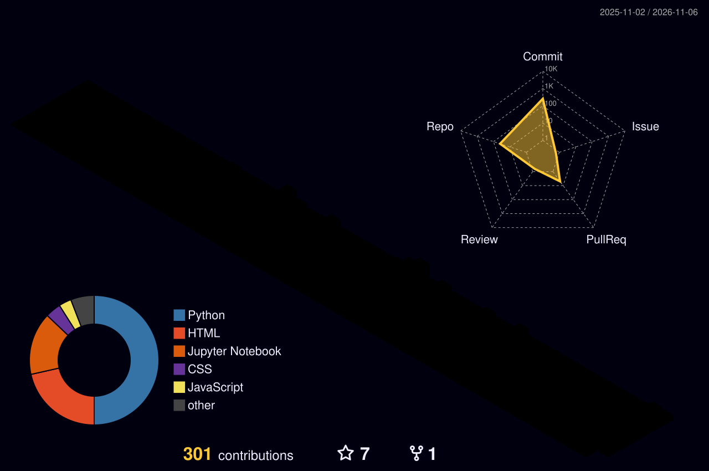

<div align="center">

# ⚡ KIRAN KUMAR PRADHAN

### `AI/ML ENGINEER` • `GENAI DEVELOPER` • `BUILDER`


</div>

---

## 🧬 `01 / ABOUT ME`

```python
class Kiran:
    def __init__(self):
        self.education = "NIT Rourkela"
        self.role = "AI/ML Developer"
        self.interests = [
            "Machine Learning",
            "Deep Learning",
            "Generative AI",
            "AI Agents",
            "Backend Engineering",
            "MLOps"
        ]
        self.current_focus = "Building real-world AI systems"
        self.motto = "Learn. Build. Break. Improve. Repeat."

    def say_hi(self):
        print("Welcome to my GitHub universe!")

me = Kiran()
```

## ⚡ `02 / TECH ARSENAL`

<div align="center">

### LANGUAGES


### AI / MACHINE LEARNING


### BACKEND / DATABASE / DEVOPS


</div>

## 🧠 `03 / CURRENT MISSIONS`

- [x] Machine Learning fundamentals
- [x] Deep Learning fundamentals
- [x] Generative AI fundamentals
- [ ] Advanced AI Agents and MCP
- [ ] Backend Engineering
- [ ] MLOps and CI/CD
- [ ] Open-source contributions

## 🚀 `04 / FEATURED PROJECTS`

| Project | Description |
|---|---|
| 🤖 AgentPay | Autonomous AI purchasing agent |
| 🌾 Smart Crop Advisory | AI-powered crop advisory system |
| 🎯 SkillLens | ML-based placement readiness prediction |
| 🧠 AI Voice RAG | Voice-enabled RAG assistant |

## 📊 `05 / GITHUB ANALYTICS`

<div align="center">


<br/>


</div>


<div align="center">


</div>


<div align="center">



</div>

<div align="center">

<a href="https://github.com/pradhankiran400-dotcom">

</a>

<a href="https://www.linkedin.com/in/kiran-kumar-pradhan-b65198369">

</a>

<br/><br/>


<h2 align="center">🏆 GITHUB ACHIEVEMENTS</h2>

<p align="center">
  
</p>
## 🚀 TOP PROJECTS

<div align="center">

*Building practical solutions with AI, ML, and full-stack development.*

</div>

<table>
<tr>
<td width="50%" valign="top">

### 💸 Expense Tracker

A web-based expense tracking application.

**Tech:** Full-Stack Development

[🌐 Live Demo](https://expensetracker-frontend-seven.vercel.app/login.html) · [💻 Source Code](https://github.com/pradhankiran400-dotcom/Expense_Tracker)

</td>
<td width="50%" valign="top">

### 🤖 AI Career Path Recommender

An AI-powered application for career path recommendations.

**Tech:** Artificial Intelligence · Machine Learning

[🌐 Live Demo](https://ai-career-path-recommendor.onrender.com/) · [💻 Source Code](https://github.com/pradhankiran400-dotcom/AI-Career-Path-Recommendor)

</td>
</tr>
<tr>
<td width="50%" valign="top">

### 📚 Book Recommendation System

A personalized book recommendation application.

**Tech:** Machine Learning · Recommendation Systems

[🌐 Live Demo](https://book-recommendor-system-fzjx.onrender.com/) · [💻 Source Code](https://github.com/pradhankiran400-dotcom/Book-Recommendation-System)

</td>
<td width="50%" valign="top">

### 🌐 Project Mosaic

A collaborative web development project.

**Tech:** React · Next.js · Frontend Development

[🌐 Live Demo](https://project-mosaic-zeta.vercel.app/) · [💻 Source Code](https://github.com/pradhankiran400-dotcom/Project-Mosaic)

</td>
</tr>
<tr>
<td colspan="2" valign="top" align="center">

### 🌾 Smart Crop Advisory & Farmer Distress Early-Warning System

An AI-driven project focused on agricultural advisory and early warning of farmer distress.

**Tech:** AI · Machine Learning · Data Science

[🌐 Live Demo](https://sih-latest.onrender.com/) · [💻 Source Code](https://github.com/pradhankiran400-dotcom/Smart-Crop-Advisory-Farmer-Distress-Early-Warning-System-SIH-2026-)

</td>
</tr>
</table>

<div align="center">

**More projects coming soon... ⚡**

</div>

</div>


### ⚡ `SYSTEM STATUS: ALWAYS LEARNING`

**BUILD • EXPERIMENT • INNOVATE**


</div>

